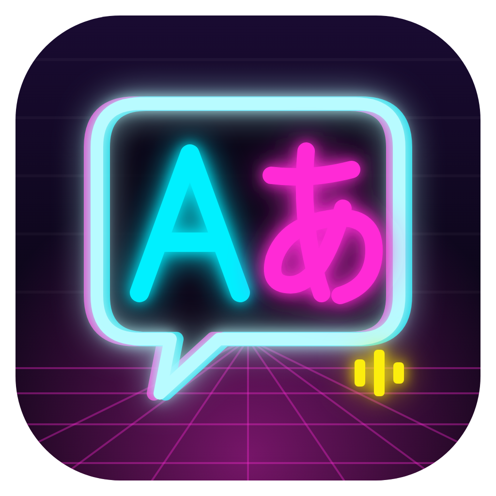

<p align="center">
  
</p>

# JELearner

本機運作的英文／日文學習秘書：自動抓英日新聞、整理成單字與文法教材、排複習、記錯題、寄週報、排行事曆，用說的練對話與跟讀。可以包成 Mac app；之後加上數位人像。

> 開發中（第二版 B 階段：課程、每日課程、復習筆記本）。已完成：私人工作區、SQLite（生字／文法／複習進度／錯題本）、英日新聞爬蟲（遵守 robots.txt）、新聞 → Markdown 教材（模板可替換）、Claude 兩種連線方式（訂閱／API key）、Gmail／Calendar 介面與模擬實作、本機網頁、離線端到端測試。
> 尚未完成：向量庫與 RAG、Google OAuth、語音對話（D 階段第二步已完成本機辨識與 15 秒錄音；語音回合計分、聽寫、聽力題待做）、Windows 安裝檔、數位人像。見 [`docs/roadmap.md`](docs/roadmap.md)。
> 第二版進行中：**0-1 起始流程與多使用者、A 階段（積分、等級、難度調整、打字版 AI 對話、今日任務與進度頁）已完成**。完整規劃（多使用者、積分與等級、AI 對話、每日課程、課程配方、語音、學習群組）：[`docs/plan.md`](docs/plan.md)。

## 執行

需要 [Rust](https://rustup.rs)（1.85 以上）。

```sh
cargo run -p jl-server
```

開啟 <http://127.0.0.1:7979>（只監聽本機）。第一次開啟會用內建的示範資料，並跳出「設定」讓你連接自己的私人工作區。

**沒有 API key、也不想連網時**（看介面、改前端）：

```sh
scripts/dev.sh --mock
```

會同時啟動模擬的 Claude API 與模擬新聞網站（`cargo run -p jl-server --example mock_services`），把私人工作區 `sources.toml` 的 feed 換成畫面上印出的網址即可。

**macOS 開發**：`scripts/dev.sh` 會用系統的 `security` 保存 API key，避免每次重新編譯都被問鑰匙圈密碼。

## 自己打包成 App（macOS 26 以上）

這個 repo 只提供原始碼，要不要包成 App 由你決定。需要 Xcode Command Line Tools（Swift）與打包工具（裝一次即可）：

```sh
cargo install tauri-cli --version "^2" --locked
cd apps/desktop
APPLE_SIGNING_IDENTITY="你的簽章名稱" cargo tauri build --bundles app
cp -R ../../target/release/bundle/macos/JELearner.app /Applications/
```

- 打包前會自動編譯語音辨識小工具 `jl-speech`（`scripts/build-speech.sh`），放進 App 一起簽章。
- App 內建伺服器（隨機埠）並開啟原生視窗，關閉時一併結束本機模型。第一次用麥克風時系統會詢問權限。
- **簽章**：Claude 的 API key 存在鑰匙圈，沒有固定簽章的 App 每次重新打包都會被要求輸入密碼。自己用的話建立一張免費的自簽憑證即可（作法見 PaperComposer 的 README「自己打包成 App」），給別人用需要 Apple Developer ID 與公證。
- **從 Finder 開啟讀不到 shell 變數**：本機模型的共用資料夾要寫在設定檔 `~/Library/Application Support/JELearner/config.toml`：

  ```toml
  [llama]
  home = "/Users/你/LocalLLM"
  ```

- 圖示原稿在 `apps/desktop/icons/logo.svg`（字母以線條繪製，不依賴字型）；換圖後在 `apps/desktop/` 執行 `cargo tauri icon icons/logo.png -o icons`。
- `cargo test`／`cargo build` 不會編譯 App（`Cargo.toml` 的 `default-members`），要打包時才需要 Swift。

## 私人工作區

生字、文法、每週素材、教材都是**個人資料，放在你自己的 private repository**（例如 `JELearner-private`），不要放進這個 repo。一個工作區可以有好幾位使用者（例如你和家人），每人一個資料夾。結構（範本見 [`workspace-template/`](workspace-template/)）：

```
JELearner-private/
  workspace.toml        工作區 id、名稱、管理員、成員
  sources.toml          新聞來源（RSS / Atom，共用）
  topics.toml           通識主題（共用）
  prompts/              自訂提示詞與教材模板（可選，共用）
  profiles/<使用者>/
    profile.toml        學習語言、各語言程度、每日目標、對話設定、週報信箱
    interests.csv       興趣關鍵字
    vocab/  grammar/    想背的單字、想學的文法（CSV，可放多個檔案）
    materials/          每週素材（materials/2026-W45/*.json）
    lessons/en|ja/      產生的教材（Markdown）
    conversations/      對話紀錄
    records/            積分（records/points/）、複習進度與錯題本（CSV）
```

**使用者**：第一次開啟時有起始流程（歡迎 → 工作區 → 使用者 → 學習語言 → Claude → 興趣 → 完成）。之後從頂列的使用者選單切換或新增使用者；選名字即可進入，不需要密碼。同一個工作區的成員看得到彼此的所有檔案（包括單字庫），適合家人；朋友請各自用自己的工作區（學習群組在之後的階段加入）。第一版的單人工作區會在開啟時詢問名字，搬到 `profiles/〈你〉/`（Git repository 裡用 `git mv`，不刪任何檔案）。

**每位使用者有自己的 Claude**：Claude Code 的登入資料夾（`CLAUDE_CONFIG_DIR`）與 API key 都依使用者分開，同一台電腦上也不會用到別人的帳號。

在「設定 → 工作區與同步」三選一：**開啟資料夾**（已有的 clone）、**建立新的**（從範本建立並推到你空白的 private repo）、**從 repo 下載**（第二台電腦）。也可以手動指定：

- 環境變數 `JELEARNER_WORKSPACE=/path/to/JELearner-private`
- 或設定檔 `JELearner/config.toml` 寫 `workspace_path = "…"`（macOS：`~/Library/Application Support/`；Linux：`~/.config/`；Windows：`%APPDATA%`）

**資料庫不在任何 repo 裡**：SQLite 放在設定資料夾的 `JELearner/data/<工作區 id>/<使用者 id>/learner.sqlite`，每位使用者各有一個。開啟工作區時會把檔案讀進資料庫，所以資料庫隨時可以重建；複習進度與錯題按「同步」或「匯出複習紀錄」時寫進 `records/`，換電腦也能還原。

欄位格式見 [`docs/data-formats.md`](docs/data-formats.md)。CSV 的標題很寬鬆（`term`／`word`／`單字`、`reading`／`読み`、`meaning`／`中文`…），從試算表或單字卡 App 匯出的檔案通常可以直接用。

## 新聞與教材

- 新聞來源寫在工作區的 `sources.toml`（預設 GOV.UK 各部會與食品標準局、ONS〔Open Government Licence〕、The Conversation UK〔CC BY-ND〕、Bank of England〔個人使用〕、Global Voices 英國〔CC BY〕、首相官邸新著情報；NHK、ITmedia、NPR 預設關閉）。只放條款允許改寫的來源，見 docs/decisions.md 第 21 節。每個網址抓取前都會檢查該網站的 `robots.txt`，同一網站的請求至少間隔 1.5 秒，User-Agent 標明 `JELearnerBot`。教材只供個人學習，請勿轉載原文。
- 「產生教材」可以選新聞、貼網址或貼文字。模型回傳固定格式的 JSON（單字、文法、問答），再由 [`prompts/lesson.md.j2`](prompts/lesson.md.j2) 排成 Markdown；提示詞也在 [`prompts/`](prompts/)。想改格式就在工作區的 `prompts/` 放同名檔案，會取代內建版本。
- 教材存成 `profiles/<使用者>/lessons/<語言>/<日期>-<標題>.md`，單字與文法同時加入複習；問答答錯的自動進錯題本。

## Claude

和 PaperComposer 一樣有兩種連線方式，在「設定 → Claude」選擇，隨時可以切換（狀態列會顯示目前用哪一種）：

- **登入帳號（訂閱）**：透過 [Claude Code](https://code.claude.com/docs/en/setup) 用你自己的 Claude Pro／Max 帳號，用量算在你的訂閱額度內。App 會偵測是否安裝 Claude Code、顯示官方安裝指令，按「用瀏覽器登入」後自動偵測登入完成。每次呼叫都在空的暫存資料夾執行 `claude -p`，關閉所有工具、不載入任何外掛設定（`--safe-mode`），並移除 `ANTHROPIC_API_KEY` 等環境變數，以免改走 API 計費。
- **API key**：按用量計費。每位使用者的 key 分開存在系統金鑰圈（macOS 鑰匙圈），沒有金鑰圈時才存在設定資料夾的 `credentials/`（僅本人可讀）；也可以用環境變數 `ANTHROPIC_API_KEY`（開發用，對這個程序的所有使用者生效）。

「使用」預設為**自動**：Claude Code 已用訂閱帳號登入就用訂閱，否則用 API key；也可以固定其中一種（`config.toml` 的 `[engine] kind = "auto" | "subscription" | "api" | "llama-server"`）。兩種方式都有「測試連線」，會標明走的是訂閱還是 API。

模型清單與預設值在 [`models/catalog.json`](models/catalog.json) 的 `cloud`，或 `config.toml` 的 `[claude] model`／`effort`，兩種連線方式共用，程式裡不寫死模型名稱。

### 關於「登入帳號（訂閱）」模式

這個模式在你的電腦上執行官方、未修改的 Claude Code，用你自己的 Claude 帳號登入。登入在 Anthropic 的頁面完成，JELearner 不會接觸、保存或轉送你的帳號憑證；請求不經過任何第三方伺服器，用量只計入你自己的訂閱額度。

Anthropic 的[使用規定](https://code.claude.com/docs/en/legal-and-compliance)寫明，訂閱額度以個人的一般使用為前提，並且不允許第三方應用代替使用者透過訂閱方案送出請求。這個模式是作者為自己的使用情境所寫；是否使用請自行判斷。若想避免疑慮，請改用 API key 模式（依用量計費，這是 Anthropic 建議開發者使用的方式）。

JELearner 是非營利的個人專案，不代付、不轉售任何 Claude 用量。

## Gmail 與 Google 日曆

目前是**模擬模式**：週報、課程確認信、複習時段都放在「信件與行事曆」頁的模擬寄件匣，內容與真正寄出的一樣。程式已實作 Gmail `users.messages.send` 與 Calendar `events.insert`／`events.list` 的 REST 介面（以模擬伺服器測試），OAuth 登入在下一階段加入。

## 讓家人一起用（家人模式）

家人共用你的 private repo，各自有自己的資料夾（`profiles/<名字>/`），**家人不需要 GitHub 帳號，也不會看到任何同步或 Git 的字眼**。在家人的電腦上由你操作一次（約 5 分鐘）：

1. 打開 JELearner，選 **請家人幫我設定**。
2. 貼上你的 private repo 網址。App 為這台電腦產生一把金鑰：照畫面的四個步驟，到 repo 的 Settings → Deploy keys 加上（勾 Allow write access），回來按「測試連線」。
3. 選位置下載 → 選「這台電腦是誰在用」或新增 → 學習語言 → **幫他登入他自己的 Claude** → 興趣。
4. 設一組 4–6 位數的**管理員 PIN**，按「交還給 ○○」。

之後家人只要打開 App：開啟時、每次學習後、關閉時都會自動同步，只上傳他自己的資料夾。設定裡只看得到學習相關的項目；工作區、Claude、本機模型收在「管理員設定」，要輸入 PIN。要停用時在「管理員設定」按「關閉家人模式」；要撤銷這台電腦，到 GitHub 刪掉那把 deploy key。

**學習戰友**：工作區有兩位以上成員時，今日頁會出現每個人的卡片（今日積分、近 7 天、連續天數、等級），資料來自大家本來就會同步的 `profiles/<名字>/records/points/`，不需要另外的服務。管理員的電腦開啟時與每 10 分鐘會自動取得最新（只做 fast-forward，不會自動上傳）。

**每週派課**：管理員在「課程」頁按一次「派本週的課」：抓最新新聞，加上主題庫還沒上過的課，替每個人（包括自己的 iPad）依各自的程度做好 7 天的課，每天 2 個主題可選，做完自動同步到 private repo，iPad 打開就看得到。一起備的人拿到同樣的主題，課文、單字數與題目依各自的程度。

**家人用 iPad**：想自己選天數、對象或內容時，在「設定 → 使用者 → 備課」備課，按同步送上 repo；家人的卡片上會顯示「課備到哪一天」，快用完時「備課」按鈕會亮起。第一次設定 iPad：在備課面板打開「第一次設定 ○○ 的 iPad」，填 iPad App 網址、repo 與兩把鑰匙，按「顯示 QR code」；在 iPad 用 Safari 打開 App 網址、加入主畫面、從主畫面打開，按「掃描電腦上的 QR code」對準螢幕就設定好了（也可以「複製連結」傳過去用 Safari 打開）。QR code 與連結含鑰匙，只在瀏覽器裡產生、不保存；掃完請收起來。QR code 由 `web/vendor/qrcode.js`（qrcode-generator，MIT）產生，iPad 用 `ipad/vendor/jsQR.js`（jsQR，Apache-2.0）讀取。iPad 首頁也有同樣的戰友卡片（`profiles/<名字>/ipad/buddies.json`，由管理員的電腦在同步、備課、收回作答時寫出）。

deploy key 讀得到整個 repo（包括你的單字庫），適合家人。只想分享進度的朋友，請等之後的「學習群組」。

## 本機模型

模型放在**所有專案共用的資料夾**，位置由環境變數 `LOCAL_LLM_HOME` 決定（從 Finder 開啟時讀不到 shell 變數，可改在 `config.toml` 寫 `[llama] home = "/path"`）。結構和 `hf download --local-dir` 相同，與 PaperComposer 共用同一份檔案：

```
<LOCAL_LLM_HOME>/gguf/<owner>/<repo>/<檔名>      模型
<LOCAL_LLM_HOME>/runtimes/llama.cpp/…/llama-server
```

「設定 → 05 本機模型」列出 [`models/catalog.json`](models/catalog.json) 的大腦（Gemma 4 E4B／12B、Qwen3.5 4B／9B、Qwen3.8 27B），標示哪些已下載；按「使用這個」就把引擎切到本機並啟動，不必先開別的程式，關閉 JELearner 時一併結束。模型以不思考模式執行（教材與對話都要固定 JSON，思考只會讓每次多等幾分鐘）。`config.toml` 寫了 `[llama] url` 時改連那台已經在跑的伺服器。

M6 32 GB 實測：Qwen3.5 4B 每秒約 31 個 token、Gemma 4 12B Q8 約 12、Qwen3.8 27B 約 8；從啟動 Qwen3.5 4B 到回答約 3 秒。

## 語音（macOS）

辨識用 macOS 內建的 Apple 語音辨識（英、日），錄音不離開電腦；朗讀用系統聲音。需要先編譯一次小工具 `jl-speech`：

```sh
cd tools/macos-speech && swift build -c release
```

伺服器會自動找到它（也可用 `JELEARNER_SPEECH_BIN` 或 `config.toml` 的 `[speech] bin` 指定）。之後在「設定 → 08 語音」下載英、日辨識模型（第一次約 2 分鐘，由系統保存）。麥克風每次最多錄 15 秒，按鈕上顯示倒數，再按一次就送出。沒有本機辨識的電腦（例如 Windows）仍可在設定裡打開瀏覽器的雲端辨識。

想要更自然的朗讀，到「系統設定 → 輔助使用 → 朗讀內容 → 系統聲音 → 管理聲音」免費下載 Premium 聲音；JELearner 會優先選用。

實機檢查（需要 Mac、`jl-speech` 與兩個辨識模型、共用資料夾裡的 Qwen3.5 4B）：

```sh
cargo test -p jl-core real_ -- --ignored
```

## 測試

```sh
cargo test
```

全部離線：核心邏輯的單元測試，加上 [`crates/server/tests/e2e.rs`](crates/server/tests/e2e.rs) 的端到端測試——用模擬的新聞網站（含 robots.txt）、Claude API、Gmail 與 Calendar，透過 HTTP 走完「連接工作區 → 抓新聞 → 被 robots.txt 擋下 → 產生教材 → 測驗與錯題 → 匯入 CSV／JSON → 複習 → 匯出紀錄 → 週報與排課 → 重新啟動 → 第二台電腦還原」。[`crates/server/tests/courses_e2e.rs`](crates/server/tests/courses_e2e.rs) 走完課程：建立主題課程 → 大綱 → 開課 → 各單元結果 → 積分與進度檔 → 筆記本與圖片 → 延伸；固定課程、每日課程、robots.txt 擋下的新聞標示。

## 專案結構

```
crates/core         工作區、SQLite、匯入、爬蟲、robots.txt、provider trait（Claude API、Claude 訂閱、llama-server）、教材生成、Google trait
crates/server       本機伺服器（127.0.0.1），之後的 Tauri 版共用同一組 handler
web/                介面（HTML / CSS / JS，不需要建置）
prompts/            教材的提示詞與 Markdown 模板（可被工作區覆蓋）
models/catalog.json 雲端與本機模型清單
workspace-template/ 私人工作區範本與示範資料
docs/               架構、決策、資料格式、介面設計、路線圖
scripts/            開發啟動與 Git hooks
```

## API

| 方法 | 路徑 | 說明 |
| --- | --- | --- |
| GET | `/api/status` | 工作區、結構（v1／v2）、使用者清單、目前使用者與等級（含 `interests.csv` 的興趣）、資料庫位置、引擎、各語言統計 |
| POST | `/api/users` `{ name, color, languages, majors, daily_minutes, interests }` | 新增使用者並以他進入 |
| POST | `/api/users/select` `{ id }` | 切換使用者（記在這台電腦） |
| PUT | `/api/user` `{ name, color, languages, majors, daily_minutes, report_email, seconds_per_turn, turns, interest_ratio, interests }` | 修改目前使用者的 profile.toml |
| POST | `/api/workspace/migrate` `{ name }` | 第一版單人工作區轉成多使用者結構 |
| POST | `/api/workspace/reindex` | 重新讀取工作區檔案 |
| POST | `/api/setup/workspace` `{ path, init }` | 開啟資料夾 |
| POST | `/api/setup/new` `{ path, remote? }` | 從範本建立（可推到 private repo） |
| POST | `/api/setup/clone` `{ url, parent }` | clone 自己的 private repo |
| GET / POST | `/api/git/status`、`/api/git/pull`、`/api/git/sync` | 同步私人工作區 |
| GET | `/api/sources` | 新聞來源 |
| GET | `/api/news?lang=&refresh=` | 新聞列表（refresh 時先抓 feed）；robots.txt 不允許擷取的標 `blocked` |
| GET / POST | `/api/articles`（POST `{ url, lang }`） | 文章；POST 抓單一網址 |
| GET / POST | `/api/lessons`（POST `{ article_id \| url \| text, lang, level }`） | 教材列表／產生教材 |
| GET | `/api/lessons/{id}` | 教材內容 |
| POST | `/api/lessons/{id}/answers` `{ answers: [{ index, answer, correct? }] }` | 作答；答錯進錯題本 |
| GET / POST / DELETE | `/api/words`、`/api/grammar`（`?lang=&q=`） | 生字與文法；手動新增會寫進工作區 CSV |
| GET / POST | `/api/review`（POST `{ kind, id, grade, in_course? }`） | 到期卡片／評分（1–5）；課程複習單元的卡片不另算一輪 |
| GET / POST | `/api/mistakes`、`/api/mistakes/{id}/resolve` | 錯題本 |
| GET | `/api/materials` | 每週素材 |
| POST | `/api/import?kind=vocab\|grammar\|materials\|auto&name=&lang=`（本文為檔案內容） | 匯入並存進工作區；`auto` 自動判斷類型（拖放） |
| POST | `/api/import/file?name=`（本文為檔案） | Markdown／文字檔、PDF、圖片（PNG、JPEG、WebP、GIF）存進 `materials/`（安全檔名、不覆蓋；依副檔名與檔頭檢查類型；文字 2 MB、圖片 10 MB、PDF 20 MB），之後的階段再讀 |
| GET | `/api/today?lang=` | 今日課程的步驟（正在上的課程的下一課，沒有課程時是每日課程；每日目標超過 60 分鐘時兩課；完成的步驟附得到的分數）、錯題任務、等級、今日積分、連續天數、過關與加分門檻 |
| GET / POST | `/api/courses?lang=`（POST `{ kind: topic, lang, keywords, sources: [{ url? , text?, title? }], lessons? }` 或 `{ kind: fixed, lang, name, vocab: [path], grammar: [path], vocab_text?, grammar_text?, file_name?, describe? }`） | 課程列表／建立主題課程（網址先檢查 robots.txt）或固定課程（上傳的清單先存進工作區） |
| GET | `/api/courses/lists?lang=` | 工作區裡可做成固定課程的單字表與文法表（`vocab/`、`grammar/`，以及為課程上傳、還沒進複習的 `recipes/lists/`，`course_only`） |
| GET | `/api/courses/{id}` | 課程大綱：每課狀態、單元與完成情形 |
| POST | `/api/courses/{id}/lessons/{n}/open` | 打開一課：第一次打開才產生內容（存進 lessons/ 與資料庫），回傳課文、題目、複習卡片 |
| POST | `/api/courses/{id}/lessons/{n}/units/{u}` `{ cards, score }`／`{ answers }`／`{ items }` | 單元結果 → 積分紀錄（分技能）、進度檔、錯題、筆記本 |
| POST | `/api/courses/{id}/extend` | 全部完成的主題課程再延伸 5 課 |
| POST | `/api/daily` `{ lang }` | 建立（或取得）今天的每日課程 |
| GET | `/api/notebook?lang=` | 復習筆記本頁面（依日期） |
| GET / PUT | `/api/notebook/{lang}/{stem}`（PUT `{ notes }`） | 一頁筆記／儲存「我的筆記」（App 區段不受影響） |
| POST / GET / DELETE | `/api/notebook/images`、`/api/notebook/images/{id}` | 筆記圖片（≤ 3 MB，只存在這台電腦） |
| GET | `/api/progress?lang=` | 進度頁：升級條件 1–3、分技能積分、最近 14 天、主題、最近得分 |
| POST | `/api/progress/assess` `{ lang }` | 立即檢查升級（每個單元結束後也會自動檢查） |
| POST | `/api/difficulty/feedback` `{ lang, feedback: too_easy\|right\|too_hard }` | 前 5 課的難度回饋（±15） |
| POST | `/api/passive` `{ lang, kind: reading\|listening, seconds }` | App 內閱讀／聆聽時間（每 50 分鐘 1 分，無法手動登記） |
| POST | `/api/lessons/{id}/finish` `{ answers }` | 教材測驗結算：積分（每份教材一次）、難度與升級 |
| GET / POST | `/api/conversations`（POST `{ lang, topic_id?, course?: { course, lesson, unit } }`） | 對話列表／開始一段對話（選題、目標字、AI 開場）；課程的對話單元用課文的主題與開場，已開始的會接續 |
| GET | `/api/conversations/next?lang=&skip=` | 下一段對話的主題（不呼叫模型） |
| GET | `/api/conversations/{id}` | 對話內容 |
| POST | `/api/conversations/{id}/turns` `{ text }` | 一回合：換句話說＋下一個問題；最後一回合後鎖定 |
| POST | `/api/conversations/{id}/finish` | 評估、積分、存成 `conversations/<lang>/*.md` |
| GET / POST | `/api/family/prepare`（POST `{ member \| members, lang, days, choices, source: library\|news\|mix }`） | 管理員替成員（可多位，可含自己）備 iPad 的課，在背景執行；GET 回傳進度 |
| GET | `/api/buddies` | 學習戰友：工作區每位成員的今日積分、近 7 天、連續天數、等級（讀各自的 `records/points/`）；管理員另外看得到家人 iPad 的課備到哪一天 |
| POST / DELETE | `/api/user/avatar`（本文為圖片，≤ 2 MB） | 上傳或移除大頭貼（存在這台電腦，不進工作區） |
| GET | `/api/avatars/{user}` | 大頭貼 |
| POST | `/api/records/export` | 寫出 records/progress.csv、mistakes.csv |
| GET | `/api/claude?fresh=` | 兩種連線方式的狀態（Claude Code 是否安裝、登入）、目前使用的引擎 |
| POST | `/api/settings/claude` `{ key, model, effort }` | 存入或移除 API key、選擇模型 |
| POST | `/api/settings/engine` `{ kind }` | 選擇引擎：auto、subscription、api、llama-server |
| POST | `/api/claude-code/login` | 啟動 `claude auth login --claudeai`（在瀏覽器登入） |
| POST | `/api/engine/test` `{ engine? }` | 測試目前的引擎，或指定 subscription／api |
| GET | `/api/models` | 模型清單與記憶體估算 |
| GET | `/api/google`、`/api/google/outbox` | Google 狀態、模擬寄件匣 |
| POST | `/api/google/weekly-report`、`/api/google/schedule-reviews`、`/api/google/book-lesson` | 週報、排複習、排課 |

## 防止洩漏個人資料

```sh
sh scripts/install-hooks.sh
```

安裝 commit 前的金鑰掃描（需要 [gitleaks](https://github.com/gitleaks/gitleaks)）。同步私人工作區時，App 也會在 commit 前檢查新增內容，看起來像 API key 或 token 就拒絕 commit。

## 開發說明

本專案由 ellrin 開發與維護，程式碼在 Claude Code（Anthropic）協助下撰寫；2026-11 的使用者體驗審查、學習戰友與每週派課由 Claude Fable 5 協作完成。
